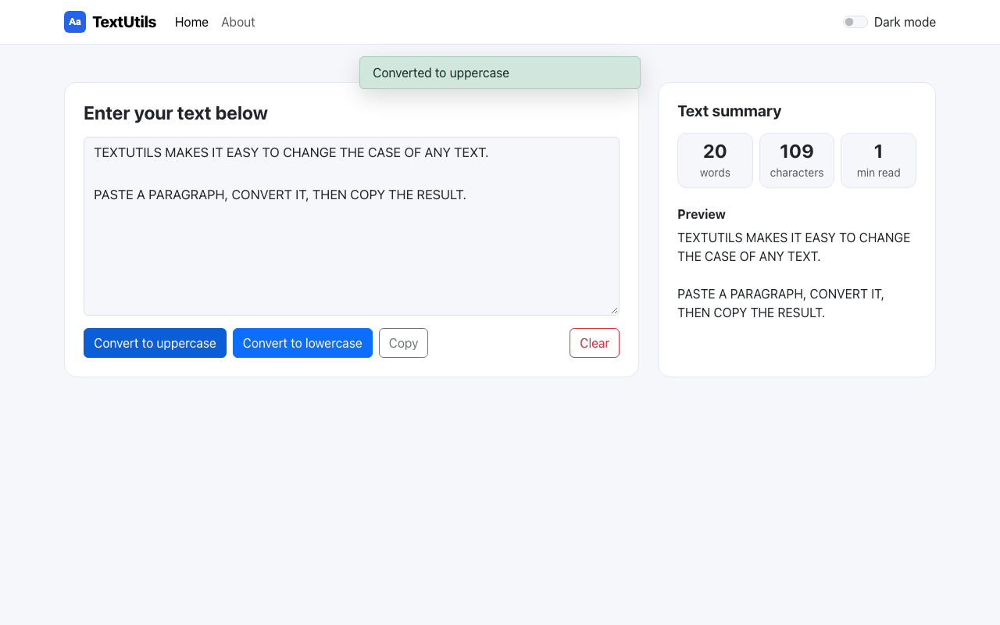
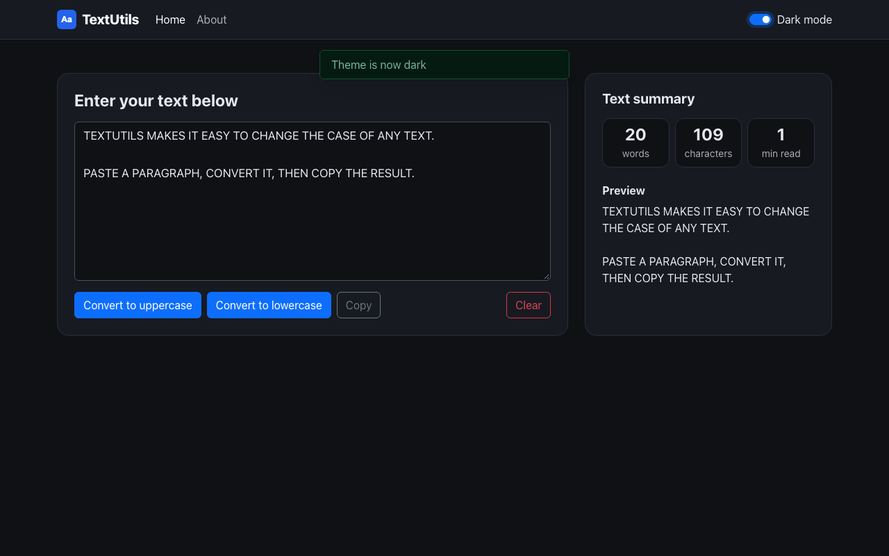
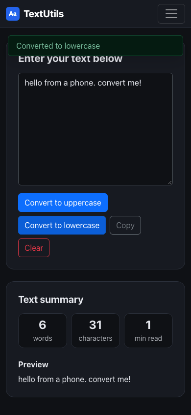

# TextUtils

A small React app for converting text to UPPERCASE or lowercase, with a live word count and a light/dark theme toggle.




| Dark mode | Mobile |
| --------- | ------ |
|  |  |

## Overview

TextUtils is a beginner React project built with function components and hooks (`useState`, `useEffect`). You paste or type text into a textarea and transform it with one click. It also shows component props (with PropTypes), state lifting, routing and auto-dismissing alerts.

## Features

- Convert the textarea contents to UPPERCASE or lowercase.
- Copy the text to the clipboard or clear it.
- A live summary: word count, character count, estimated reading time and a preview.
- A dark mode switch in the navbar using Bootstrap 5.3 color modes. It follows your system setting on the first visit, is remembered in `localStorage`, and shows a short alert when it changes.
- An About page (`/about`) with an accordion of FAQs.
- Client-side routing with React Router and a responsive layout.

## Tech stack

- React 18 (hooks), PropTypes
- React Router 6
- Bootstrap 5.3 (via CDN in `public/index.html`)

## Project structure

```
Textutils/
├── public/
└── src/
    ├── App.js              # theme state, alerts, routes
    ├── App.test.js         # conversion and dark-mode tests
    └── components/
        ├── Navbar.js       # nav links + dark-mode switch
        ├── TextUpper.js    # textarea, buttons and summary
        ├── Alert.js
        └── About.js
```

## Getting started

### Prerequisites

- Node.js 18 or later and npm

### Install and run

```bash
git clone https://github.com/VamsiKrishnaThota03/Textutils.git
cd Textutils
npm install
npm start        # http://localhost:3000
```

Other scripts:

| Command         | Description                      |
| --------------- | -------------------------------- |
| `npm run build` | Production build in `build/`     |
| `npm test`      | Run the tests                    |

No environment variables are needed.

## Known limitations

- Only uppercase and lowercase conversion are available.
- `npm audit` still reports issues in Create React App's build tooling (`react-scripts` 5) that need a breaking upgrade.
